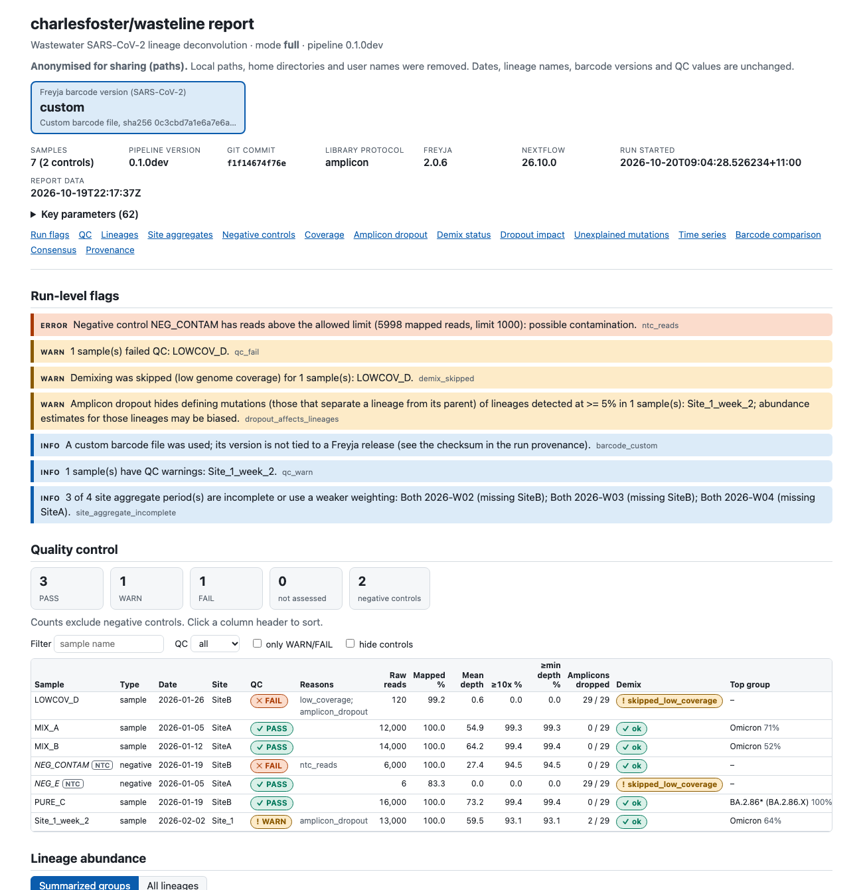
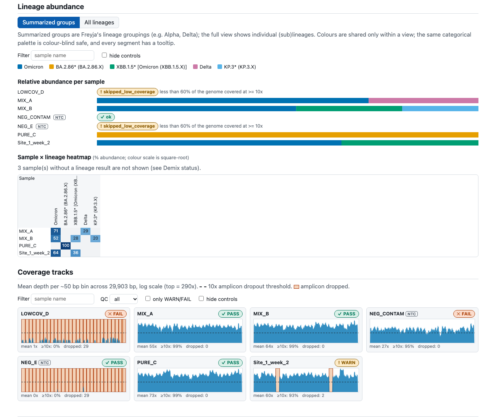
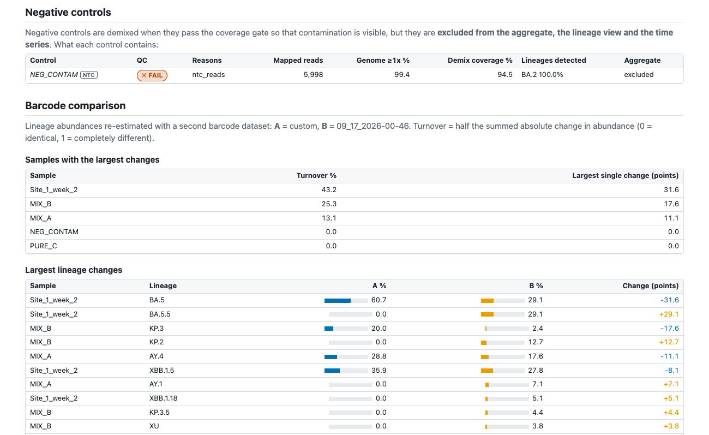

```
    _.-"""-._
  .'  .---.  '.     __        ___    ____ _____ _____ _ _
 /   /  _  \   \    \ \      / / \  / ___|_   _| ____| (_)_ __   ___
|   |  ( )  |   |    \ \ /\ / / _ \ \___ \ | | |  _| | | | '_ \ / _ \
 \   \  '  /   /      \ V  V / ___ \ ___) || | | |___| | | | | |  __/
  '.  '---'  .'        \_/\_/_/   \_\____/ |_| |_____|_|_|_| |_|\___|
    '-.___.-'
      |   |_______________________________________________________________
      |   :   wastewater SARS-CoV-2 lineage abundance
      |   |_______________________________________________________________
      |___|
```

[](https://github.com/charlesfoster/wasteline/actions/workflows/ci.yml)
[](https://www.nf-test.com)
[](https://www.nextflow.io/)
[](https://www.docker.com/)
[](https://sylabs.io/docs/)
[](https://docs.conda.io/en/latest/)
[](https://github.com/nf-core/tools/releases/tag/4.1.0)

<!-- UNVERIFIED: the GitHub repository (charlesfoster/wasteline) was not reachable when this README was written, so the CI badge and the clone URL below are unchecked. -->

## Introduction

**charlesfoster/wasteline** is a [Nextflow](https://www.nextflow.io/) pipeline that estimates **SARS-CoV-2 lineage
abundances in wastewater** from Illumina amplicon or probe-capture (e.g. Twist) sequencing data. It trims and maps the reads, removes primers, runs
[Freyja](https://github.com/andersen-lab/Freyja) to demix lineages, aggregates and plots the samples, assesses coverage, amplicon
dropout and negative controls, builds per-sample consensus genomes, and writes a single self-contained HTML report. It is
a port of the wastewater workflow of
[`covid-illumina-snakemake`](https://github.com/charlesfoster/covid-illumina-snakemake) to Nextflow (DSL2, nf-core style),
and runs on Linux with Docker (the production target; also macOS with Docker, Singularity/Apptainer and conda are supported
profiles).

## Features

- **Five modes** selected with `--mode`: `full` (reads to report), `demix` (re-run the lineage estimate on existing Freyja
  variants/depths, for example with newer barcodes, including results from the old Snakemake pipeline, never modifying them),
  `aggregate` (aggregate and plot existing `.demix` files), `report` (re-render the HTML report of a finished run) and
  `update_db` (download the current Freyja data).
- **Amplicon and probe-capture libraries.** `--protocol capture` handles probe-capture data (e.g. Twist): no primer trimming,
  no amplicon-dropout analysis, PCR duplicates marked. `--skip_primer_trimming` is for already-trimmed amplicon reads.
- **Reproducible and traceable.** One Freyja barcode dataset is resolved per run and shared by all samples
  (`--barcodes latest|container|<YYYY-MM-DD>|<stamp>|<file or directory>`); its version and checksums are recorded in
  `pipeline_info/run_info.json`, every per-sample status file, `summary/demix_status.tsv` and the report header. A run never silently falls back to
  a different dataset. Every container is pinned to an exact tag (and optionally to a digest with `-profile locked`).
  Sample IDs are never rewritten.
- **Updatable Freyja data.** Datasets downloaded with `--barcodes latest` (or `--mode update_db`) are stored under `--db_dir` and can be
  pinned later by date or exact version, used offline, or replaced by your own barcode file.
- **Compare barcode versions.** `--compare_barcodes <latest|container|date|path>` demixes every sample a second time with
  another dataset and reports per-lineage abundance changes (`summary/barcode_compare.tsv`, a report panel); both datasets are
  recorded in `run_info.json`.
- **Uncertainty.** `--freyja_boot` adds bootstrap 95% intervals per lineage (`freyja boot`; `summary/freyja_boot_summary.tsv`,
  shown in the report tooltips).
- **Never a silent failure.** A sample that is skipped (too little coverage) or fails to demix gets a row with a status and a
  reason; it does not abort the run or leave an empty file that looks like a result.
- **Checks that catch quiet errors.** The declared primer scheme is tested against where the reads actually start
  (`primer_scheme_check` in `qc_summary.tsv`), the report says which dropped amplicons hide lineage-informative sites
  (`summary/dropout_impact.tsv`), and frequent variants the lineage mixture does not explain are listed
  (`summary/unexplained_mutations.tsv`, a screening aid, not a variant caller).
- **QC and negative controls.** Per-sample coverage QC (PASS/WARN/FAIL), per-amplicon coverage and dropout for nine bundled primer
  schemes (all use the bundled reference's contig name; or bring your own BED). Negative controls are demixed so contamination is visible
  (own table and report section, kept out of the aggregate by default) and raise a run-level flag when they have reads.
- **Consensus genomes** with IUPAC ambiguity codes for mixed sites and `N` masking of low-depth positions; optional
  `--annotate_variants` lists the amino-acid consequences of the applied variants (`bcftools csq`).
- **Surveillance outputs.** With collection dates (and optionally a `viral_load` column) in the samplesheet: a time-aware plot,
  long time-series tables per site (`summary/freyja_timeseries[_lineages].tsv`, plain and viral-load-weighted), and, opt-in,
  Freyja relative growth rates (`--freyja_growth`) and the interactive Freyja dashboard (`--freyja_dash`); all modes, also from
  existing `.demix` files.
- **Lineage groups you maintain yourself.** `summary/lineage_summary.csv` has one row per sample and one column per group of
  lineages (`JN.1*`, `KP.3*`, `RECOMBINANT*`, ...), defined in a CSV you can edit in Excel; a curated list is bundled and on by
  default, `--lineage_groups my.csv` replaces it, a copy of the list used is published (`lineage_groups_used.csv`) and
  `lineage_ungrouped_summary.tsv` shows which lineages the list does not cover yet.
- **Site aggregation.** `--site_aggregation sites.csv` combines per-site results into groups of sites (weekly, weighted by viral
  load or population served) by averaging the **results**, never by pooling reads; `summary/site_aggregates_*.tsv`.
- **Shareable report.** `--report_anonymize paths|full` removes file paths, user names and (with `full`) sample IDs and site names from
  the report; the lineage summary also comes as a formatted Excel workbook (`summary/lineage_summary.xlsx`).
- **Optional** mutations-of-interest tracking; `--bam_format cram` for much smaller alignments; `--aligner minibwa` (experimental,
  see [docs/aligner_evaluation.md](docs/aligner_evaluation.md)); `bin/replay_run.py` rebuilds the exact command of a recorded run, and `bin/reanalyse_runs.py` re-estimates past runs with newer Freyja barcodes (no re-mapping) and shows what changed ([docs/reanalysis.md](docs/reanalysis.md)). `bin/runs_store.py` keeps past runs in one SQLite store and flags emerging lineages, growth, recurring unexplained mutations and watchlist mutations across runs (screening hints, [docs/runs_store.md](docs/runs_store.md)).
- **One offline HTML report**: run-level flags, QC table, lineage abundance bars and heatmap, coverage tracks, amplicon dropout,
  demix status, negative controls, barcode comparison, provenance. Readable with 100+ samples (see [docs/report.md](docs/report.md)).
- Helper scripts to make and check samplesheets, including from the results of a previous (or legacy Snakemake) run.

## Pipeline summary

```
FASTQ pairs (samplesheet)                       Freyja data: --barcodes latest | container | date | stamp | file
      |                                                   (FREYJA_DATA, resolved once per run)
  FASTP -> BWA_MEM -> SAMTOOLS_VIEW (-F 4) -> [READ_STARTS -> PRIMER_SCHEME_CHECK]  |
           (or MINIBWA_MEM)                     -> IVAR_TRIM -> SAMTOOLS_SORT       |
                                                  |                                 |
                                           FREYJA_VARIANTS  ->  variants.tsv + depths
                    +-------------------------+---------------------+             |
                    |                         |                     |             |
        QC_SAMPLE + AMPLICON_COVERAGE   consensus chain         FREYJA_DEMIX <-----+  per sample, with a coverage gate
        (coverage QC, dropout)          (ivar -> VCF -> filter  |  status: ok | failed | skipped_low_coverage
                    |                    -> depth mask ->       |
                    |                    bcftools -> stats)  FREYJA_AGGREGATE_PLOT  (negatives excluded by default)
                    |                         |                     |
                    +-------------------------+----------+----------+
                                                         |
                          PROVENANCE (run_info.json) -> BUILD_REPORT_DATA -> RENDER_REPORT -> summary/report.html

mode demix:      existing variants + depths  ->  FREYJA_DEMIX -> aggregate/plot, QC, consensus, report
mode aggregate:  existing .demix files       ->  FREYJA_AGGREGATE_PLOT -> report
mode report:     results of a finished run   ->  RENDER_REPORT
mode update_db:  nothing                     ->  FREYJA_UPDATE (stores the dataset in --db_dir)

after the demix: LINEAGE_SUMMARY (default; bundled groups list), SITE_AGGREGATE (--site_aggregation), DROPOUT_IMPACT, UNEXPLAINED_MUTATIONS(_CONCAT), TIMESERIES_TABLE (all modes), and opt-in
                 FREYJA_RELGROWTHRATE (--freyja_growth) and FREYJA_DASH (--freyja_dash)

optional branches (full and demix): --compare_barcodes (second FREYJA_DEMIX + BARCODE_COMPARE), --freyja_boot (FREYJA_BOOT),
                                    --annotate_variants (ANNOTATE_VARIANTS), --mutations_of_interest (MUTATIONS_OF_INTEREST)
```

## Quick start

1. Install [Nextflow](https://www.nextflow.io/docs/latest/install.html) **>= 26.04** and [Docker](https://docs.docker.com/get-docker/)
   (running). Older Nextflow versions cannot run the pipeline.
2. Make a samplesheet from a directory of paired FASTQs (needs Python >= 3.9; or write the CSV yourself, see
   [docs/usage.md](docs/usage.md#3-samplesheets)):

   ```bash
   git clone https://github.com/charlesfoster/wasteline.git   # gives you bin/make_samplesheet.py
   python wasteline/bin/make_samplesheet.py /path/to/fastq_dir -o samplesheet.csv
   ```

   Illumina names `<id>_S<n>_L001_R1_001.fastq.gz` are expected (`--suffix` changes that). Files with `NEG_`/`NC_` in the name become
   negative controls. The sheet has the columns `sample,fastq_1,fastq_2[,sample_type][,collection_date][,site][,viral_load]`.

3. Run:

   ```bash
   nextflow run charlesfoster/wasteline \
       -profile docker \
       --input samplesheet.csv \
       --outdir results \
       --primer_scheme midnight
   ```

   `--primer_scheme` names the scheme of your library; if you leave it out, `qiagenv1` (QIAseq Direct SARS-CoV-2) is used (the old
   Snakemake pipeline defaulted to `midnight`).

4. Open `results/summary/report.html` in a browser. The tables (`summary/demix_status.tsv`, `qc_summary.tsv`, `freyja_aggregated.tsv`,
   `consensus_genomes.fasta`) and the per-sample files are described in [docs/output.md](docs/output.md).

To try the pipeline first on the bundled synthetic data (about five minutes), follow [docs/QUICKSTART.md](docs/QUICKSTART.md).

> [!WARNING]
> Provide pipeline parameters on the command line (`--param value`) or with Nextflow's `-params-file`. Custom config files
> given with `-c` are for resources and infrastructure only, **not** parameters (they are validated against the schema).
> Boolean flags work as `--x`, `--x true`, `--x false` and `--x=false` on Nextflow >= 26.04.

## What the report looks like

`summary/report.html` is one self-contained file (no network needed to open it). Screenshots of the report for the
synthetic test data ([docs/QUICKSTART.md](docs/QUICKSTART.md)); the contaminated negative control `NEG_CONTAM` raises the
run-level error flag, while its demix status stays `ok`:







A complete example you can open in a browser: [docs/example_report.html](docs/example_report.html) (synthetic data; download the
file and open it locally, GitHub shows the HTML as source). How to read each panel: [docs/report.md](docs/report.md).

## Documentation

| Page                                                                 |                                                                           |
| -------------------------------------------------------------------- | ------------------------------------------------------------------------- |
| [docs/QUICKSTART.md](docs/QUICKSTART.md)                             | test the pipeline on synthetic data                                       |
| [docs/usage.md](docs/usage.md)                                       | the user guide: samplesheets, modes, Freyja data, settings, profiles, HPC |
| [docs/parameters.md](docs/parameters.md)                             | every parameter                                                           |
| [docs/output.md](docs/output.md), [docs/report.md](docs/report.md)   | outputs and the HTML report                                               |
| [docs/troubleshooting.md](docs/troubleshooting.md)                   | failure modes and fixes                                                   |
| [docs/migration_from_snakemake.md](docs/migration_from_snakemake.md) | moving from `covid-illumina-snakemake`                                    |
| [docs/README.md](docs/README.md)                                     | the full index (including developer docs)                                 |

## Credits

charlesfoster/wasteline was written by Charles Foster, building on the Snakemake pipeline
[`covid-illumina-snakemake`](https://github.com/charlesfoster/covid-illumina-snakemake) and on
[Freyja](https://github.com/andersen-lab/Freyja) (Karthikeyan et al., _Nature_ 2022).

## Contributions and support

If you would like to contribute, please see the [contributing guidelines](docs/CONTRIBUTING.md) and the
[development guide](docs/development.md). Problems and questions: open an issue on GitHub.

## Citations

An extensive list of the tools used by the pipeline (and how to cite them) is in [`CITATIONS.md`](CITATIONS.md). Please cite Freyja and the other
tools whose results you use. There is no release DOI for wasteline yet.

This pipeline uses code and infrastructure developed and maintained by the [nf-core](https://nf-co.re) community, reused here
under the [MIT license](https://github.com/nf-core/tools/blob/main/LICENSE).

> **The nf-core framework for community-curated bioinformatics pipelines.**
>
> Philip Ewels, Alexander Peltzer, Sven Fillinger, Harshil Patel, Johannes Alneberg, Andreas Wilm, Maxime Ulysse Garcia, Paolo Di Tommaso & Sven Nahnsen.
>
> _Nat Biotechnol._ 2020 Feb 13. doi: [10.1038/s41587-020-0439-x](https://dx.doi.org/10.1038/s41587-020-0439-x).

## Licence

[MIT](LICENSE).
